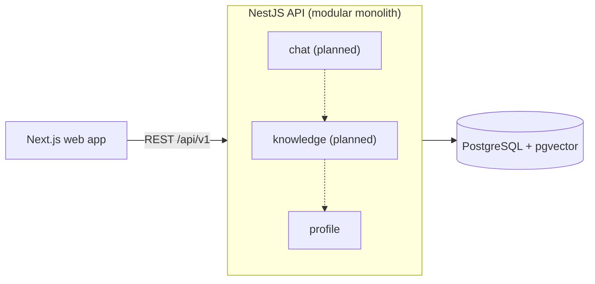

# Interactive CV

My personal website and interactive CV. I'm Ruslan Ibragimov, a Senior Software Engineer
(Node.js/TypeScript backend, event-driven systems).

The site is two things at once:

- **A CV** - a fast CV page served from the API, plus an AI chat that answers questions about my
  experience, grounded only in CV data and with cited sources.
- **A demonstration of production engineering** - the repository, architecture decisions, CI
  pipeline, and operational baseline are part of the product. If you are an engineer reviewing this
  repo, start with [Architecture](#architecture) and the [ADRs](#architecture-decision-records).

Scope is in the [charter](docs/charter.md); progress and open decisions are in the
[roadmap](docs/roadmap.md).

## v1 goals

| Area        | Target                                                                                          |
| ----------- | ----------------------------------------------------------------------------------------------- |
| Chat        | Answers only from CV data, cites sources, refuses off-topic and prompt-injection attempts       |
| Quality     | A golden eval set gates every merge that touches the chat                                       |
| Performance | CV page LCP p75 < 2.5 s; chat time-to-first-token p95 < 3 s                                     |
| Cost        | LLM spend ≤ $5/month, enforced by a daily token budget with a circuit breaker and per-IP limits |
| Delivery    | lint → typecheck → test → build → deploy on every merge to `master`                             |

**Deliberate non-goals:** user accounts, a CMS or multi-user platform, a blog (in v1), a
general-purpose chatbot, heavy frontend animation, Kubernetes, Kafka, microservices, and
multi-LLM-provider adapters. Each would add cost without serving the product at this scale. Where a
rejection is non-obvious, I record it in an ADR.

## Architecture

A **modular monolith** ([ADR-002](docs/adr/002-architecture-style.md)): one deployable NestJS
application split into modules that each own one business capability, with hexagonal layering inside
each module. It fits a project with one maintainer (me), low and bursty traffic, and a $0/month
hosting budget (free tiers only), while leaving a clear extraction path if a module ever needs its
own service.



| Module      | Responsibility                                                             | Status   |
| ----------- | -------------------------------------------------------------------------- | -------- |
| `profile`   | CV content (experience, skills, projects) served to the web app            | Sprint 0 |
| `knowledge` | Source documents, chunking, embeddings in pgvector                         | Planned  |
| `chat`      | RAG answers with citations, LLM integration, guardrails, and cost controls | Planned  |
| `contact`   | Contact form and notifications                                             | Post-v1  |

### Module structure and boundaries

```
apps/api/src/modules/<context>/
├── domain/           # entities, value objects, domain errors, repository ports
├── application/      # use cases (one class per use case), application ports
├── infrastructure/   # repository implementations, mappers, external adapters
├── presentation/     # controllers, request/response mapping
└── <context>.module.ts
apps/api/src/shared/  # shared kernel: config, logging, errors, DB client, health
```

These rules are enforced in CI by
[dependency-cruiser](https://github.com/sverweij/dependency-cruiser). A violation fails the build.

- **Layering:** `domain` imports nothing outside itself (no framework, ORM, or I/O). `application`
  depends only on `domain`. `infrastructure` implements ports. `presentation` calls use cases, never
  repositories.
- **Public surface:** each module exposes its application ports and DTOs through a single entry
  point. Other modules never import its internals.
- **Data ownership:** a module's tables are read and written only by its own `infrastructure` layer.
- **Contracts:** only `presentation` imports `packages/contracts`, so API contracts and domain
  models change independently.

### Chat isolation

The chat shares a process with the CV page, so it is built with timeouts, concurrency limits, per-IP
rate limits, a daily token budget, and graceful degradation: the CV stays usable when the chat or
the LLM provider is down. The chat reaches other modules only through ports, so extracting it into
its own service would mean replacing in-process adapters with network clients. Domain and
application code would stay as they are. I extract it only when a concrete trigger is observed
(listed in ADR-002), not in anticipation.

## Repository structure

A pnpm workspaces monorepo without a build orchestrator
([ADR-003](docs/adr/003-repository-structure.md)).

```
apps/
├── api/              # NestJS modular monolith (HTTP entrypoint; worker entrypoint later)
└── web/              # Next.js presentation layer
packages/
└── contracts/        # shared API schemas/types - no Nest or React dependencies
docs/
├── charter.md
├── roadmap.md
└── adr/
tsconfig.base.json    # strict compiler options extended by every workspace
eslint.config.js      # one lint config for all workspaces
.prettierrc
```

- `apps/*` may depend on `packages/*`. Packages never depend on apps, and apps never import each
  other. This is enforced in CI.
- `packages/contracts` is the only code shared between the API and the web app. There is no generic
  `shared` or `utils` package.
- Internal packages are consumed through their built output (`package.json` `exports`), not
  TypeScript path aliases, so what runs locally is what runs in the container.
- TypeScript, ESLint, and Prettier configs live at the repository root and apply to every workspace,
  so there is one source of truth for tooling and no config package to maintain.
- The API and web app build into separate images with production dependencies only, and deploy
  independently.

## Tech stack

| Area                     | Choice                                                                   |
| ------------------------ | ------------------------------------------------------------------------ |
| Language                 | TypeScript (strict)                                                      |
| Module format            | ESM in every workspace                                                   |
| Runtime                  | Node.js (Active LTS)                                                     |
| API                      | NestJS                                                                   |
| Web                      | Next.js                                                                  |
| Database                 | PostgreSQL with pgvector                                                 |
| Monorepo                 | pnpm workspaces                                                          |
| Lint / format            | ESLint (flat config, `typescript-eslint` strict type-checked) + Prettier |
| Architecture enforcement | dependency-cruiser                                                       |
| CI                       | GitHub Actions                                                           |

ESLint uses `typescript-eslint`'s type-aware rule set, so bugs such as floating or misused promises
fail the lint step. In async, event-driven code these are a common source of silent production
failures. Prettier handles formatting only. Both are configured once at the repository root.

I track open tool decisions (ORM, testing, contract authoring, hosting, LLM provider) in the
roadmap's [Open decisions](docs/roadmap.md#open-decisions) table and add them here once made.

## Getting started

### Prerequisites

- Node.js - the exact version is pinned in `.nvmrc`, so `nvm use` or `fnm use` selects it; `engines`
  in `package.json` accepts only that major version
- pnpm 10 or later, installed any way (e.g. `npm install --global pnpm`). Inside the repository,
  pnpm switches itself to the exact version pinned in the `packageManager` field of `package.json`.
  Corepack is not needed: Node.js no longer bundles it.
- Docker - for local PostgreSQL and integration tests
- Linux, macOS, or Windows with WSL2. On WSL2, clone into the Linux filesystem (not `/mnt/c`):
  installs and file watching are much slower across the boundary.

### Scripts

Run from the repository root.

| Script              | What it does                                                  |
| ------------------- | ------------------------------------------------------------- |
| `pnpm lint`         | Lints every workspace with ESLint, including type-aware rules |
| `pnpm format`       | Formats every file with Prettier                              |
| `pnpm format:check` | Fails if any file is not formatted; nothing is written        |

## Testing

| Level       | Scope                                                   |
| ----------- | ------------------------------------------------------- |
| Unit        | Domain and application logic; ports are mocked          |
| Integration | Repositories and DB behaviour against a real PostgreSQL |
| E2E         | HTTP through the full NestJS app with a real database   |

Tests check behaviour, not implementation, and never depend on each other's state or order. Once the
chat exists, a golden eval set (deterministic checks plus LLM-as-judge) gates merges that touch it.

## API conventions

- REST + JSON under `/api/v1`. No breaking changes to `v1` responses without an ADR.
- Errors use [RFC 9457](https://www.rfc-editor.org/rfc/rfc9457) problem details
  (`application/problem+json`) from a single global exception filter.
- An OpenAPI spec is served at `/api/docs` (non-production) and exported as a CI artifact.
- Health checks: `GET /health/live` (process up) and `GET /health/ready` (database reachable).
- IDs are UUIDv7, generated by the application rather than the database. Timestamps are
  `timestamptz` in the database and ISO-8601 UTC in the API.
- Database migrations are committed, reviewed, and run as a separate step, never on application
  boot.
- CV content is versioned seed data. Updating the CV never requires a code change.

## Git workflow and CI

- `master` is protected: even as the only contributor, I land every change through a pull request
  with green CI, **squash-merge only** ([ADR-001](docs/adr/001-commits-strategy.md)).
- The PR title becomes the commit on `master`, so PR titles follow
  [Conventional Commits](https://www.conventionalcommits.org/): `type(scope)?: description`. The
  allowed types are `feat`, `fix`, `refactor`, `docs`, `ci`, and `chore`. A CI check enforces this.
- The PR workflow runs lint → typecheck → test → build.
- Workflow hardening: third-party actions are pinned to full commit SHAs, `permissions` are
  least-privilege, and every job sets a timeout.

## Architecture Decision Records

I record decisions that are hard to reverse, or that a reviewer would question, as ADRs in
[`docs/adr/`](docs/adr/) (Context, Decision, Alternatives considered, Consequences).

| ADR                                         | Decision                                        |
| ------------------------------------------- | ----------------------------------------------- |
| [001](docs/adr/001-commits-strategy.md)     | Squash-merge with Conventional Commit PR titles |
| [002](docs/adr/002-architecture-style.md)   | Hexagonal modular monolith                      |
| [003](docs/adr/003-repository-structure.md) | pnpm workspaces monorepo, no build orchestrator |
